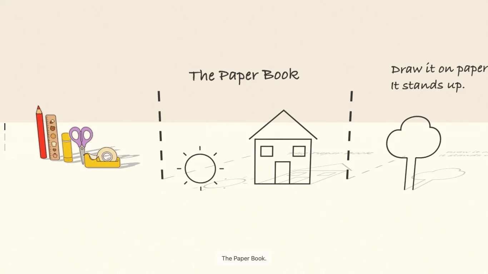

# The Paper Book

A child's drawn and stapled story book, turned into a paper world you walk through by scrolling.
Each drawing stands up as a pencil cut-out on its own paper and casts a real shadow. This
repository holds the code and the tools with a three-page sample book. The real book is not here.
You can see it live at <https://daughter-doodle.vercel.app>.



## Folders

- `site/` is the web page. It is plain HTML, CSS and JavaScript with one copy of three.js inside
  it. No build step. Serve the folder with any static file server and open it.
- `tools/` turns a photographed page into pencil cut-outs and checks that it worked.
- `sample/page.jpg` is the sample page. `./tools/sample.sh` draws it and cuts `site/assets/` from it.

## Run it

```
python3 -m http.server 8765 --directory site
```

Then open http://localhost:8765. The still version of the page, for a browser without WebGL or a
reader who prefers less motion, opens with `?nogl=1`.

## Make your own book

The tools need ImageMagick 7. `grid.sh` labels its grid in Arial on macOS and in fontconfig's sans
font elsewhere. `sample.sh` and `dedication.sh` use a font that ships with macOS.

1. Photograph each page flat, in even light. Keep the photos in `archive/`, which git ignores.
2. `./tools/grid.sh archive/page.jpg grid.jpg` draws coordinates over a photo, to find each crop.
3. `./tools/cutout.sh archive/page.jpg site/assets/01-cat.webp WxH+X+Y` cuts one drawing. Add
   `--colour` for a glued-in picture. It refuses a crop whose edge cuts through a line.
4. `./tools/paper.sh archive/page.jpg WxH+X+Y site/assets/paper.webp` makes the paper from a blank
   area of a page.
5. Add one `section.scene` per page to `site/index.html`, and its movement to `site/moments.js`.

A runner that moves with the scroll is a 3 x 3 sprite sheet, listed as `data-id="runner"` in the
hidden `.additions` element of `site/index.html`. The sample book has none.

`cutout.sh` and `paper.sh` remove each photo's metadata, including its GPS location. The original
photos still carry it, so keep them out of any public repository. The page asks search engines not
to index it or its images. Keep that for a real child's book.

## Check it

```
./tools/check.sh
node --test tools/
```

## Licence

The code, the tools and the sample book are under the MIT licence in `LICENCE`. three.js keeps its
own MIT licence, in the header of `site/vendor/three.module.js`.
